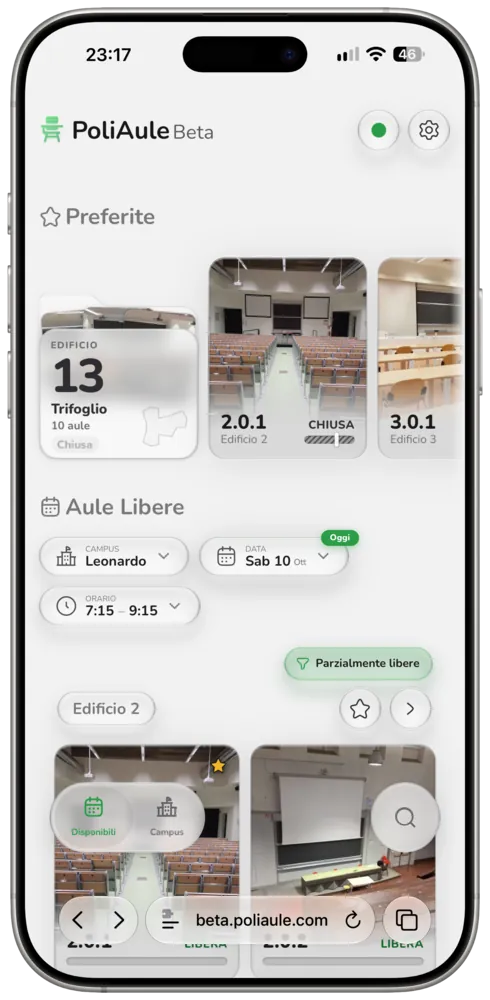
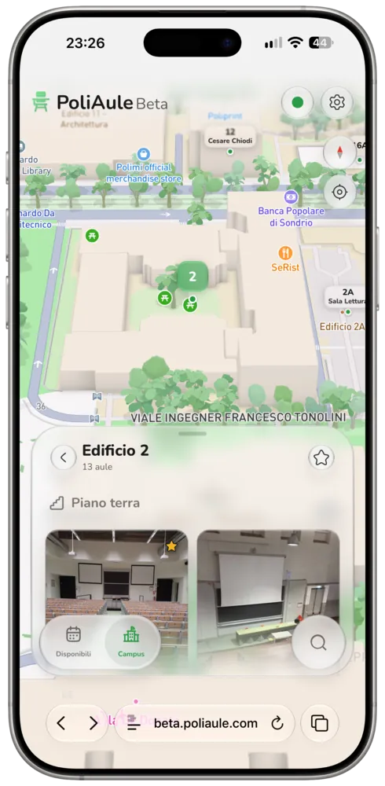
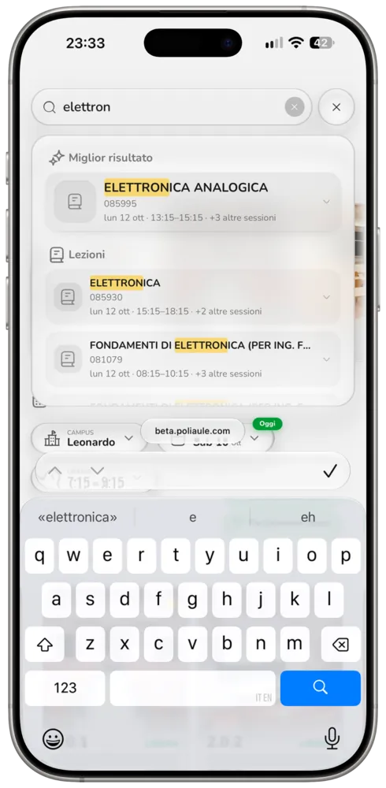

<div align="center">
  
  <h1>PoliAule</h1>
  <p><strong>Find a free classroom at Politecnico di Milano, in seconds.</strong></p>

  [](https://poliaule.com)

  [](https://github.com/SummaCristian/poliaule/releases/latest)
  [](https://poliaule.com)
  [](https://github.com/SummaCristian/poliaule/actions/workflows/fetch-occupancy.yml)
  [](./LICENSE)
</div>

<br>

<p align="center">
  
  
  
  
</p>

## What it does

Pick a campus, a day and a time window, and PoliAule shows you every classroom that's free: right now, later today, or any day in the next week. No account, no app to install, no checking rooms one by one.

Each result tells you more than whether a room is free: seat count, power outlets, projector, whether it's a lab or a lecture hall, and a photo, so you can avoid unwanted surprises (coff coff 6.0.1).

Built by students, for students. Because finding a place to study shouldn't be harder than it needs to be.

## Features

- **Available rooms** across every PoliMi campus, for today or any day in the next week, with a custom time window
- **Favourites**: pin the classrooms and buildings you use most, from any campus
- **Campus map**: explore each campus in 3D, find where your class is hiding, and discover rooms you didn't know existed
- **Search anything**: classrooms, buildings, courses, exams and professors
- **Classroom pages**: features, photo, full weekly schedule, opening hours and the building on a map
- **Installable** as a PWA on mobile and desktop, with offline support
- **Light and dark mode**, in 🇬🇧 English and 🇮🇹 Italian
- **Seasonal themes**: Halloween, Christmas and graduation days get their own touches

## Stable and Beta

<table align="center">
  <tr>
    <td align="center" width="250">
      <a href="https://poliaule.com">
        <br>
        <strong>PoliAule</strong>
      </a><br>
      <sub>poliaule.com<br>for daily use</sub>
    </td>
    <td align="center" width="200">
      <a href="https://beta.poliaule.com">
        <br>
        <strong>PoliAule Beta</strong>
      </a><br>
      <sub>beta.poliaule.com<br>upcoming features</sub>
    </td>
  </tr>
</table>

## How it works

Early every morning, then hourly during the day, a scheduled job scrapes fresh occupancy data from Politecnico di Milano's online services (falling back to its REST API for anything missing) and uploads it to Cloudflare R2. When you open PoliAule, the app reads that data through its own small API, never from Politecnico directly: fast for you, gentle on PoliMi's servers.

```
GitHub Actions → PoliMi online services → Cloudflare R2 → API Worker → your browser
```

The frontend is plain HTML, CSS and JavaScript bundled by Vite, built on [Vitrium](https://github.com/SummaCristian/Vitrium), a Liquid Glass-inspired design system that grew out of this project.

More in the docs: [architecture](./docs/architecture.md), [frontend](./docs/frontend.md) and the public [API](./docs/api.md).

## Contributing

PoliAule is open source under the [MIT license](./LICENSE). The app, the data pipeline and the deployment setup all live in this repository.

Found a bug or have an idea? [Open an issue](https://github.com/SummaCristian/poliaule/issues). Want to contribute? Pick an open issue, or start from the [docs](./docs/) to find your way around.

## Disclaimer

This project is not affiliated with, endorsed by, or connected to Politecnico di Milano in any way. Use at your own risk.
