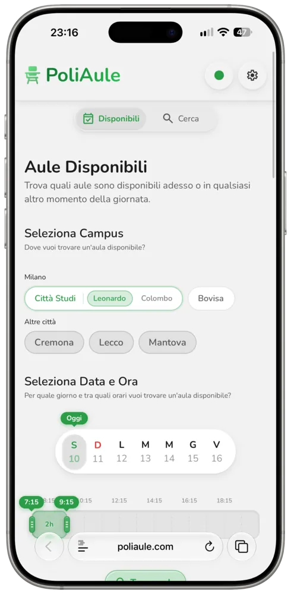
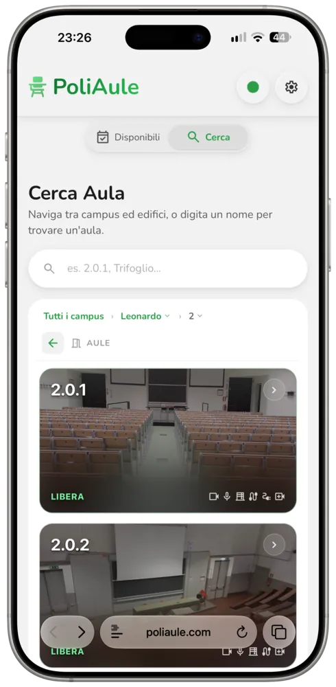
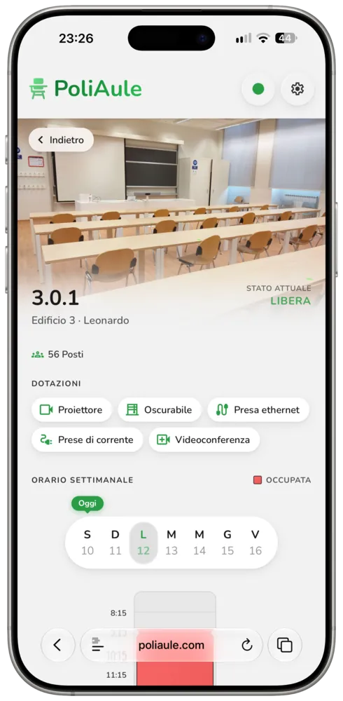
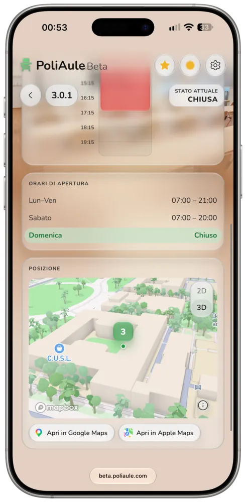

I'm proud to announce that, after many months of hard work, PoliAule 2.0 is finally available!

Here's what's new:

- A redesigned Available tab
- Meet the all-new Campus tab
- A redesigned Search experience
- A redesigned Classroom Details page
- Built on Vitrium, my own design system
- An overhauled backend
- New logos
<!-- more -->
This is one of the biggest efforts I have ever put into a single project in my life, bigger than any university project and any exam. I started working on it well before PoliAule 1.0 was released back in May, when the priority was to get something out as soon as possible for everyone to use. That version was clearly rushed, and I always felt it could have been so, so much more, which is why I kept working on the real, complete PoliAule experience in parallel.

It was supposed to be released in time for the new academic year. Unfortunately I didn't make it, but I hope it's not too late for you to appreciate the work that has been poured into it.

This release redesigns every aspect, every screen and every component of PoliAule. Everything was questioned, evaluated and then tweaked, redesigned, or torn down and rebuilt from scratch.
So much has changed in one way or another, and I could write for hours about all the minuscule details I obsessed over for entire days, but I'll let you discover them on your own. Instead, here is a list of the biggest changes in this release.

## The redesigned Available tab
The Available tab is the most important part of PoliAule: it's the whole reason it exists.

Because of that, I couldn't let it be a mere list of classrooms and a few selectors. Too boring...

The tab is now home to a bunch of new features that turn it into a dashboard of your university.
At the top, a banner sometimes shows important information you may need to know.
Right below it, the all-new Favourites section lets you pin your favourite classrooms and buildings from any campus, so they're always one tap away.

The results themselves have been completely reimagined: a new look, a better information hierarchy, and a faster, more intuitive experience.

The pickers have also been rebuilt from scratch: they're always at your fingertips, with intuitive gestures to help you find what you need, when you need it.

 

## The all-new Campus tab
What PoliAule needed was the ability to guide you around your campus not only in time, but also in space. Picture it as a T.A.R.D.I.S., just without the timey-wimey stuff.

The brand-new Campus tab lets you explore the campus on an interactive 3D map, to find out where exactly they managed to hide your class this time, how to get there, or a reason not to go (hey, that's valid too!).

More importantly, it lets you discover classrooms you might never find otherwise, like that event-only classroom you'll need to find the one time you're running late, or something like that (any resemblance to personal experience is purely coincidental).

## Find what you need in the new Search experience
With the Campus tab now taking care of exploring the campus, Search is finally free to focus on what people expect from something with that name: the ability to search for absolutely anything. And the new Search delivers: classrooms, buildings and occupations, but also course names, exams and even professors.

 

## The updated Details page
The redesigned Details page has a more modern look, with a colourful background and glass containers.

It also shows new information about each classroom, like where its building is on a map, or its opening and closing hours.

The Details page's opening animation has been rebuilt from scratch too, to feel native without sacrificing performance.

  

## Vitrium, PoliAule's design system
PoliAule uses Vitrium, my own design system. Although saying it like that is actually wrong, it's more like the opposite: while working on PoliAule 2.0, at some point I realised I was building something really nice, so I extracted it from this codebase and generalised it into a component library, which PoliAule now uses.

Vitrium is open source: you can find it at [vitrium.summacristian.com](https://vitrium.summacristian.com) or on [GitHub](https://github.com/SummaCristian/Vitrium). It's a Liquid Glass-inspired library that prides itself on two things: a faithful recreation of Liquid Glass, using complex hand-made techniques such as ring shadows and refraction through glass, and rich, stunning components that make use of those materials.

All of PoliAule's core components are either native Vitrium components, like the new tab bar, or built on the foundations Vitrium provides. It's a good example of how versatile the design system can be: feel free to explore it, and use it in your own projects if you like it!

> [!NOTE]
> Vitrium, and therefore PoliAule, supports a refraction effect through glass, only in Chromium-based browsers for now. Firefox, Safari and their derivatives will skip this effect until they support the technology that makes it work...

## Don't forget the backend
The entire backend has been revised, and partly rewritten, in preparation for 2.0.

The occupancy fetch, the most important piece, is now 10x faster, going from ~20 minutes to ~2 minutes per run. This is thanks to a new approach based on scraping web pages, rather than cautiously hitting the official-but-not-public API with ~2,000 requests per run.

There are also new backend modules that plug their data into the API, along with new endpoints to play with:

- `GET /v1/graduation-sessions`: PoliMi's graduation days and the campuses each one is held at
- `GET /v1/photos/:id`: a classroom's photo, served by PoliAule instead of PoliMi
- `GET /v1/photos/:id/thumb`: the same photo scaled down to 640px, for small previews

All the details are in [`docs/api.md`](https://github.com/SummaCristian/poliaule/blob/main/docs/api.md).

## New logos, same personality
The logos of both PoliAule and its Beta version have been redesigned with a more modern, Liquid Glass-esque look and feel. I hope you like them!

 
